<div align="center">

[中文](README.md) · **English**

# JIMAO · "AAA" FPS

**A single-file browser first-person shooter · early access build**

[](https://github.com/odin1024/jimao/actions/workflows/pages/pages-build-deployment)
[](https://github.com/odin1024/jimao/releases/latest)


[](LICENSE)

> The harbor defense grid has gone rogue. Cut three uplink relays, break the lockdown, and board the extraction boat.

### [▶ Play now in your browser](https://odin1024.github.io/jimao/)

[⬇ Download offline build v1.0.0](https://github.com/odin1024/jimao/releases/latest/download/jimao-v1.0.0.html) (one 1.4MB HTML file — double-click to play, no internet needed)

Best on desktop Chrome / Edge · playable on mobile touch · gamepad supported

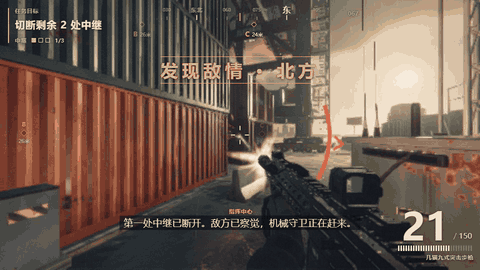

*▲ Real gameplay, captured live from the public site*

</div>

---

## About

**JIMAO** ("几猫", roughly *"how many cats"*) is a **fully self-contained, single-file browser FPS**: the entire game — render engine, shaders, level, audio, UI — lives inside one 1.4MB HTML file. Double-click to play. No install, no build step, zero external requests.

The story opens at 05:42 in Berth No. 4 of Jimao Harbor: the defense grid's master control has mutinied and sealed the entire port. As the only operator of the Jimao assault squad on site, you must infiltrate the container yard, warehouse and docks, cut three uplink relays to collapse the lockdown, then board the extraction boat. Every relay you cut triggers a radio callout from command — aerial **mecha gulls** and ground **mecha hounds** converge in waves until you leave the harbor.

The "domestic AAA blockbuster" branding is an intentional inside joke (see the in-game *About* screen). The rendering and gunfeel, however, are dead serious: procedural wet asphalt, rust-and-chipped-paint containers, AgX cinematic tone mapping, soft shadows and rain curtains — all generated in real time by GLSL.

## Highlights

- **Rendering**: WebGL2 + three.js r180 (inlined), AgX tone mapping, PCSS soft shadows, procedural sky with volumetric clouds, rain curtains and puddle reflections
- **Materials**: zero textures — asphalt/concrete expansion joints, wetness gradients, raindrop ripples, rust and paint chipping, worn container markings, all procedural GLSL
- **Combat**: "Jimao Type-9" assault rifle (holographic sight, ADS, three-stage reload, shell ejection and muzzle flash), melee, enemy waves, hit/kill feedback, directional damage indicators
- **Narrative**: live command-center radio subtitles, objective tracking, compass tape with world-space markers, wave-warning banners
- **UI**: harbor-authority insignia × cinematic dark visuals; title / pause / death / mission-briefing menu states; end-of-run rating (Clean Sweep / Sharp & Decisive / Against All Odds)
- **Audio**: fully synthesized WebAudio — gunshots, reloads, shell casings, rain, wind, music motifs; no audio files
- **Input**: keyboard & mouse (pointer lock + fallback look mode), touch virtual joystick, standard gamepad; four auto-adapting quality tiers

## Screenshot tour

All shots captured live from the public site (1600×900 desktop and 390×844 touch viewports).

| | |
|:---:|:---:|
| 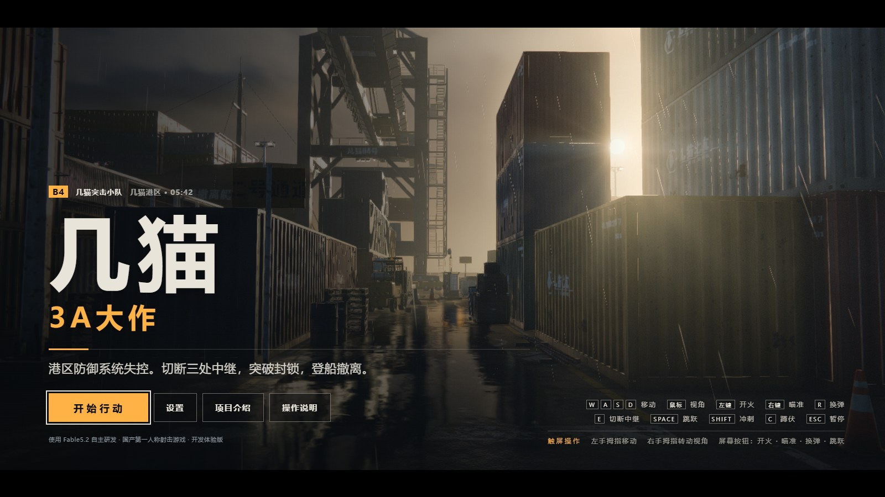 | 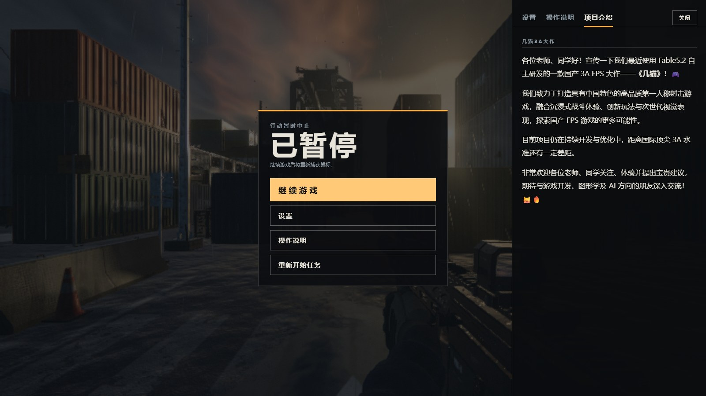 |
| **Title screen**: harbor-authority branding, cinematic dark UI | **About**: lore and dev disclaimer |
| 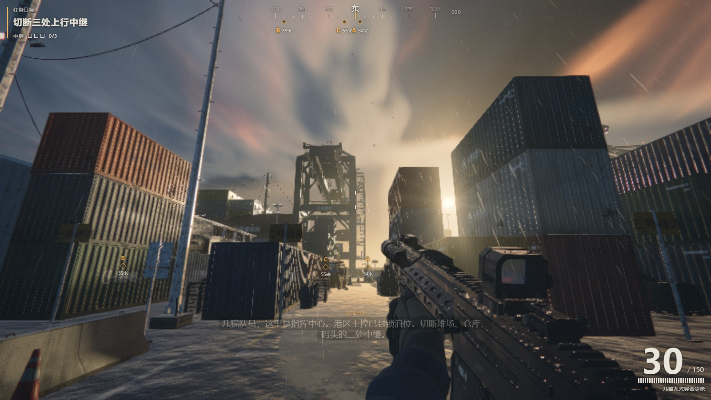 | 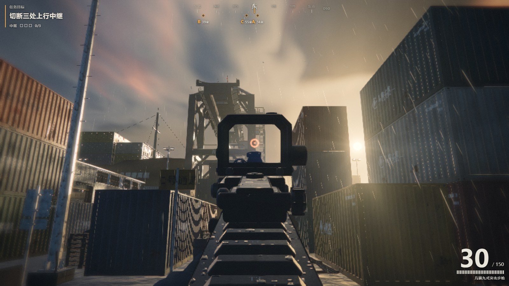 |
| **Combat HUD**: compass tape, objective diamonds, radio subtitles, ammo counter | **ADS**: holographic sight centered, procedural sky and rain |
| 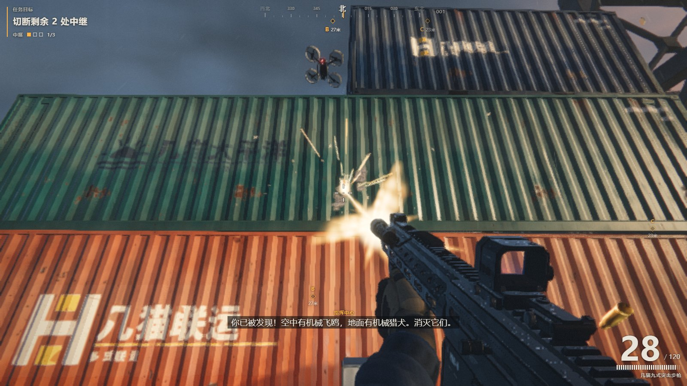 | 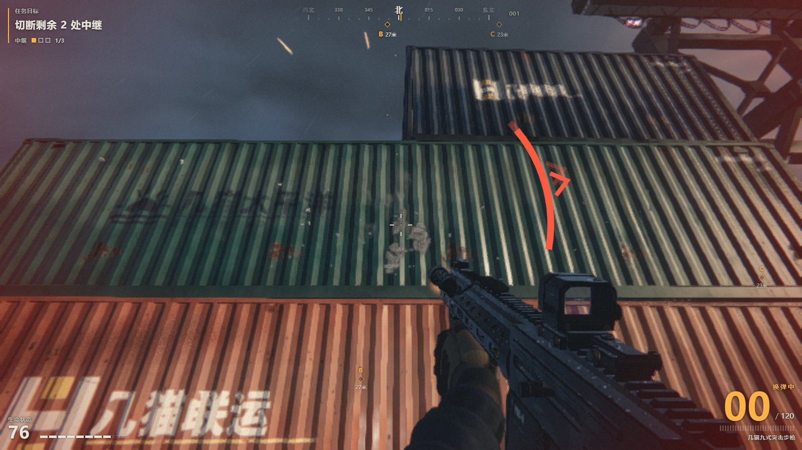 |
| **Firefight**: mecha gull closing in — muzzle flash, ejected shell, hit sparks | **Under fire**: directional damage arc, HP and reload prompt |
| 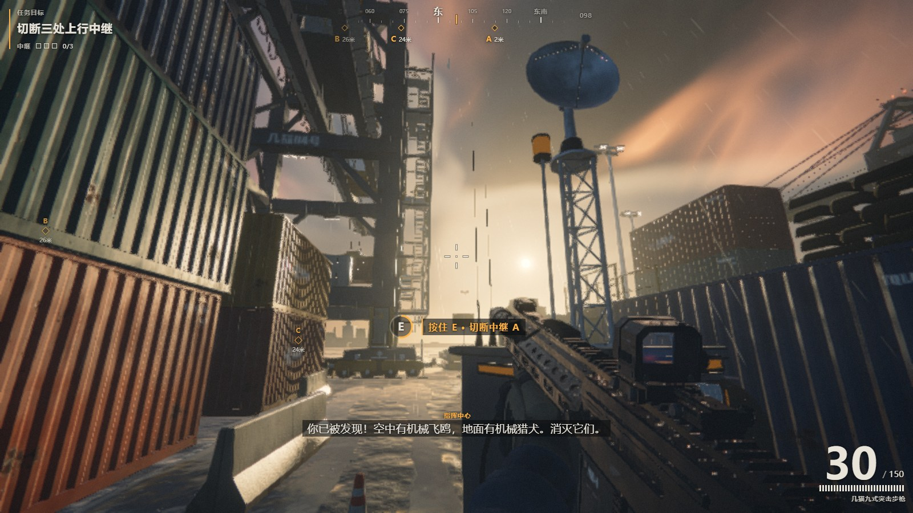 | 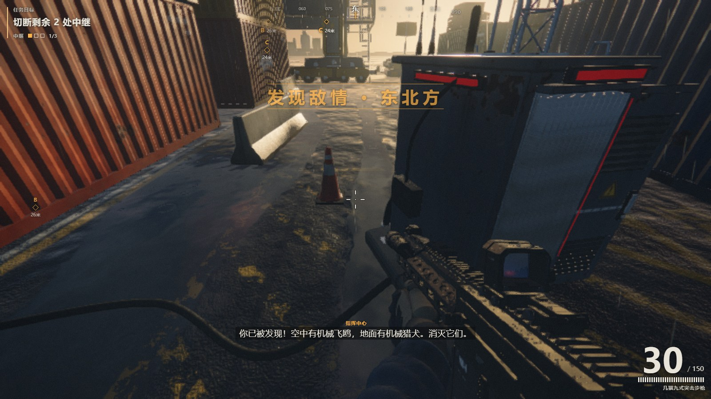 |
| **Relay cut**: hold-E interaction ring, relay tower and dish antenna | **Wave warning**: enemy callout banner with bearing after a relay cut |
| 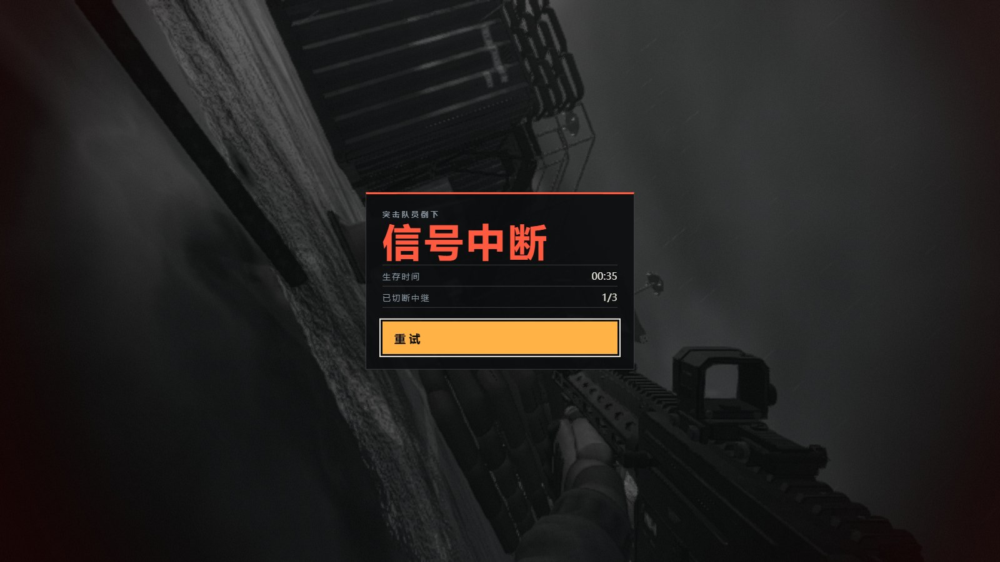 | 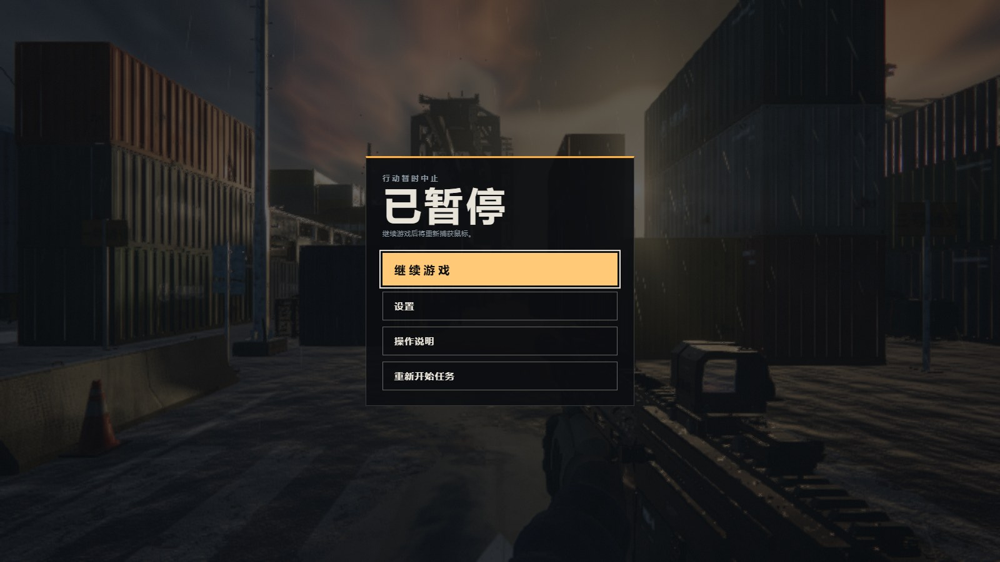 |
| **KIA**: signal-lost card with survival time and relay progress | **Paused**: resume / settings / restart |
| 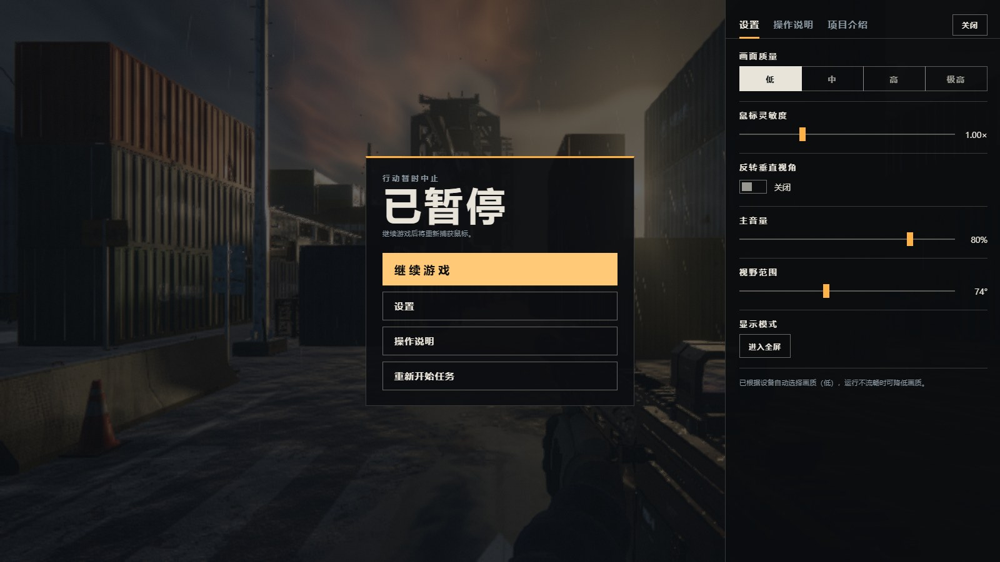 | 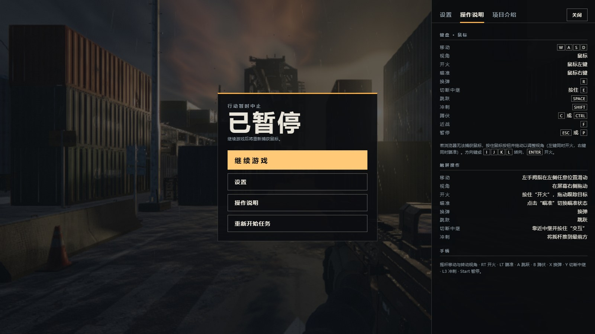 |
| **Settings**: four quality tiers, sensitivity, invert, volume, FOV, fullscreen | **Controls**: keyboard / touch / gamepad schemes |
| 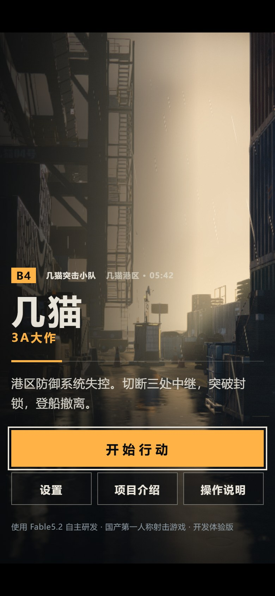 | 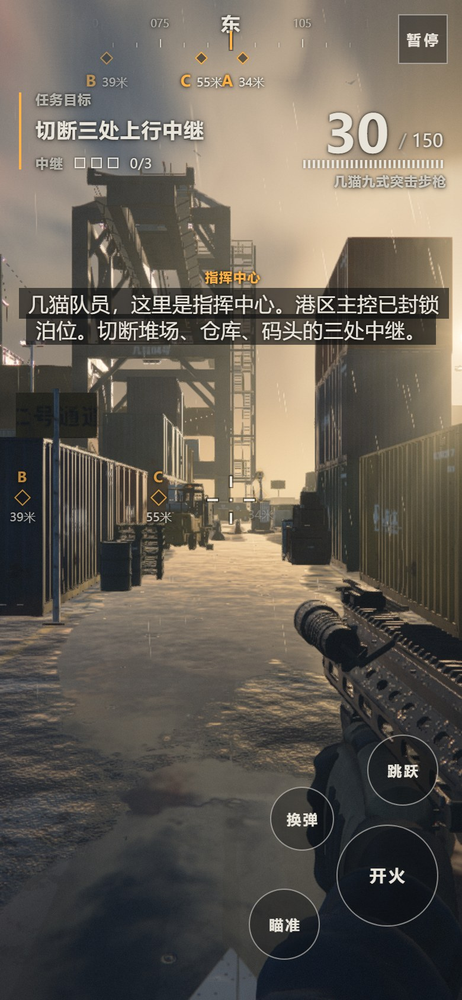 |
| **Mobile title**: portrait layout with reading scrim | **Mobile gameplay**: virtual joystick + fire / aim / reload / jump |

## Gameplay loop

1. **Infiltrate**: spawn in the Berth No. 4 corridor; the compass and world markers guide you to three relays (Yard A / Warehouse B / Docks C)
2. **Cut**: hold `E` near a relay to complete the interaction ring; each cut spawns an enemy wave
3. **Break out**: mecha gulls (air) and mecha hounds (ground) swarm you — use container cover, sprint and crouch to survive
4. **Extract**: with all three relays cut, the lockdown lifts; reach the extraction point and board the boat
5. **Debrief**: rated on time, accuracy, kills and retries

Death costs nothing but progress: a retry restarts the mission from the beginning with the relay count reset.

## Controls

### Keyboard & mouse

| Action | Key | Action | Key |
|---|---|---|---|
| Move | `W` `A` `S` `D` | Jump | `Space` |
| Look | Mouse | Sprint | `Shift` |
| Fire | Left mouse | Crouch | `C` / `Ctrl` |
| Aim (ADS) | Right mouse | Melee | `F` |
| Reload | `R` | Pause | `Esc` / `P` |
| Cut relay | Hold `E` | Look (no pointer lock) | Arrow keys / `I` `J` `K` `L` |

### Touch

| Action | Gesture |
|---|---|
| Move | Left thumb anywhere on the left half (push the stick fully to sprint) |
| Look | Drag on the right side of the screen |
| Fire / Aim | Hold "Fire" and drag to track / tap "Aim" to toggle |
| Reload / Jump / Interact | On-screen buttons; hold "Interact" near a relay |

### Gamepad

Sticks move & look · `RT` fire · `LT` aim · `A` jump · `B` crouch · `X` reload · `Y` cut relay · `L3` sprint · `Start` pause

## Graphics & settings

- **Four quality tiers** (Low / Medium / High / Ultra): auto-selected per device, shadow and reflection quality tied to the tier; shadows and reflections take a moment to regenerate after switching
- **Mouse sensitivity** 0.2–3.0×, **invert Y**, **master volume**, **field of view** (default 74°), **fullscreen toggle**
- If the frame rate drops, lower the quality tier; environments without pointer lock (some embedded browsers) automatically fall back to move-to-look

## Technical architecture

```
index.html (1.4MB, single file)
├─ CSS        dark HUD / menus / touch controls / prefers-reduced-motion
├─ three.js   r180 inlined & minified (renderer / scene / post chain)
├─ GLSL       procedural sky · AgX grading · PCSS soft shadows · wet ground/
│             puddles/rain ripples · rust & paint-chip damage model ·
│             worn container markings · flickering lights
├─ Game logic mission state machine · wave scheduler · enemy AI ·
│             gunfeel · hit detection
├─ WebAudio   fully procedural SFX synthesis (guns/reload/ambience/music)
└─ DOM UI     compass tape · objective markers · radio subtitles ·
              four-state menu · settings panel
```

- **Zero external requests**: no CDN, no textures, no audio files; works offline via `file://`
- **Post chain**: scene → soft shadows → AgX (Filament/Blender fit) → display-linear grading → output
- **Ground material**: bicubic B-spline sampled data maps, no pixel edges up close; continuous wetness drives roughness and normals
- **Performance**: clamped frame delta, quality tiers, frustum culling; software-rendered environments auto-downgrade

## Run locally & deploy

```bash
# Option 1: just double-click index.html (runs over file://)
# Option 2: local static server
python -m http.server 8080
# open http://localhost:8080
```

Hosted on GitHub Pages (`main` branch root): pushes rebuild automatically in about a minute.
To ship an update: replace `index.html` with the new build → commit → push; tag milestone versions and publish a [Release](https://github.com/odin1024/jimao/releases) with the offline HTML attached.

## Roadmap

- [ ] More weapons & attachments (shotgun / sniper, sight magnification)
- [ ] Expanded enemy roster and elite units
- [ ] Level expansion: warehouse interior and dock-crane top route
- [ ] Local persistence for settings and best scores
- [ ] Gamepad rumble and adaptive trigger feedback

## Feedback & disclaimer

Feedback, bug reports and ideas are welcome via [Issues](https://github.com/odin1024/jimao/issues) (Chinese issue templates are provided; English is fine too).

Licensed under the [MIT License](LICENSE).

> This is an early-access build independently developed with Fable5.2. The "domestic AAA blockbuster" label is a marketing joke — there is still a real gap to top-tier international AAA production, and development continues. Friends in game dev, graphics and AI are very welcome to reach out.

<div align="center">

**[▶ Deploy again](https://odin1024.github.io/jimao/)** · Jimao Assault Squad · Berth No. 4 · 05:42

</div>