<div align="center">

# 几猫 · 3A大作

**单文件浏览器第一人称射击 · 开发体验版**

[](https://github.com/odin1024/jimao/actions/workflows/pages/pages-build-deployment)


> 港区防御系统失控。切断三处中继，突破封锁，登船撤离。

### [▶ 立即在线体验](https://odin1024.github.io/jimao/)

桌面 Chrome / Edge 体验最佳 · 手机触屏可玩 · 支持手柄

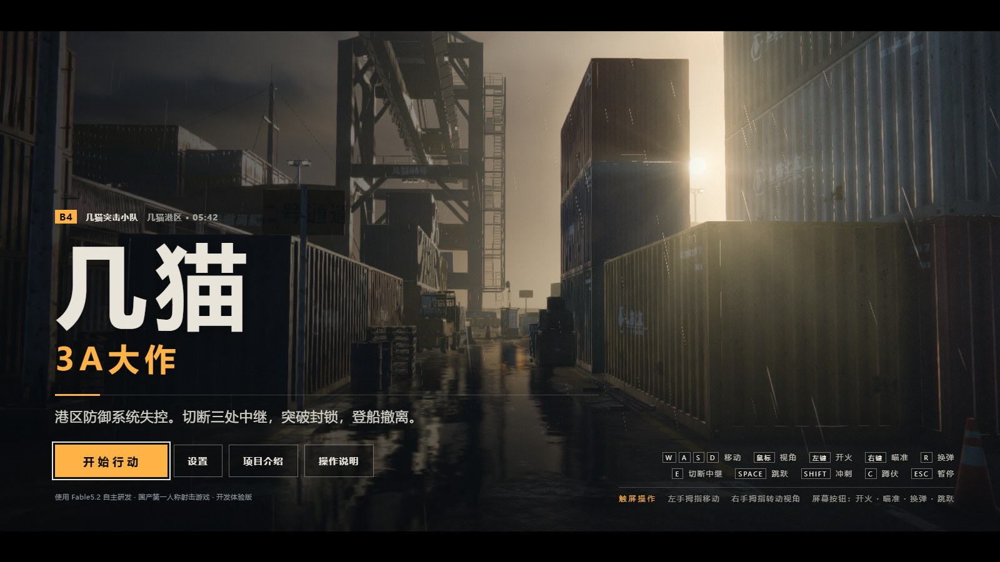

</div>

---

## 关于本作

《几猫》是一款**完全自包含的单文件浏览器 FPS**：整个游戏——渲染引擎、着色器、关卡、音频、UI——全部装在一个 1.4MB 的 HTML 文件里，双击即玩，无需安装、无需构建、无外部资源请求。

故事发生在清晨 05:42 的几猫港区四号泊位：防御系统主控叛变，封锁了整座港口。你作为几猫突击小队唯一在场的队员，需要潜入堆场、仓库与码头，切断三处上行中继，瓦解封锁，最后登船撤离。每切断一处中继，指挥中心都会通报敌情——空中的**机械飞鸥**与地面的**机械猎犬**会逐波围攻，直到你离开港口。

本项目以"国产 3A 大作"为宣传梗（见游戏内《项目介绍》），但渲染与手感是认真做的：程序化湿滑地面、锈迹掉漆的集装箱、AgX 电影级调色、软阴影与雨幕，全部由 GLSL 实时生成。

## 核心特性

- **渲染**：WebGL2 + three.js r180（内联），AgX 色调映射、PCSS 软阴影、程序化天空与体积云、雨幕与地面积水反射
- **材质**：零贴图——沥青/混凝土伸缩缝、水洼湿度渐变、雨滴涟漪、锈迹与掉漆、集装箱磨损标识，全部程序化 GLSL
- **战斗**：几猫九式突击步枪（全息瞄具、ADS、换弹三段动作、抛壳与枪口焰）、近战、波次敌潮、命中/击杀反馈、受击方向指示
- **叙事**：指挥中心无线电实时字幕、任务目标追踪、罗盘带与世界空间目标标记、波次警告横幅
- **UI**：港务局标识 × 电影片头式深色视觉；标题/暂停/阵亡/行动简报四态菜单；行动评级（干净利落 / 精准果断 / 险象环生）
- **音频**：WebAudio 实时合成——枪声、换弹、弹壳落地、雨声、风声、音乐动机，无音频文件
- **输入**：键鼠（指针锁定 + 无锁定降级视角）、触屏虚拟摇杆、标准手柄；画质四档自动适配

## 截图巡览

以下全部为公网站点实机截取（1600×900 与 390×844 触屏视口）。

| | |
|:---:|:---:|
| 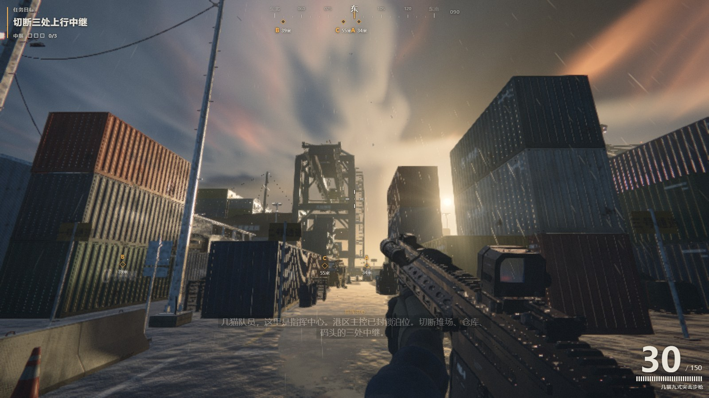 | 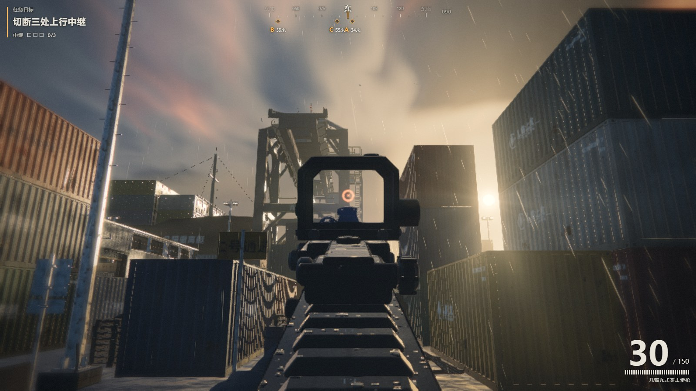 |
| **实战 HUD**：罗盘带、目标菱形标记、无线电字幕、弹药计数 | **ADS 瞄准**：全息瞄具居中，程序化天空与雨幕 |
| 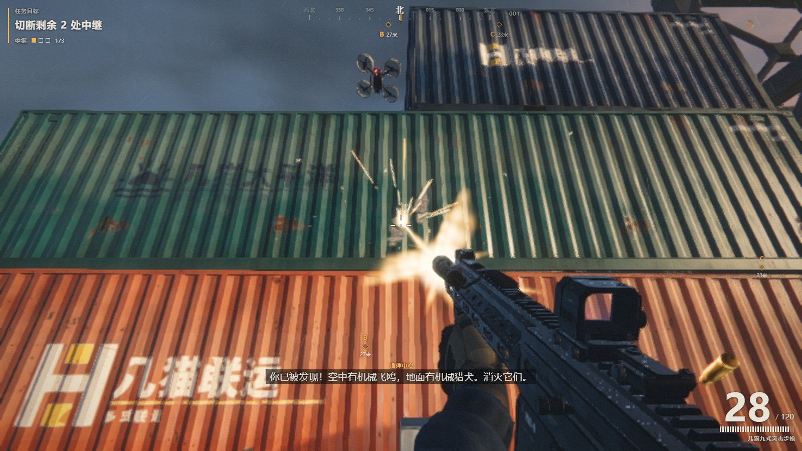 | 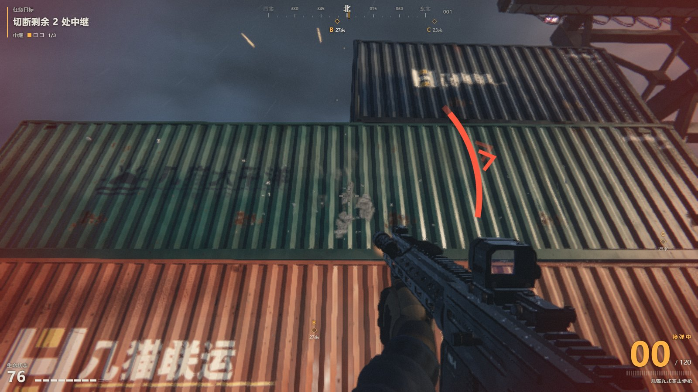 |
| **交火**：机械飞鸥逼近，枪口焰、抛壳与命中火花 | **受击**：方向弧指示伤害来源，血量与换弹提示 |
| 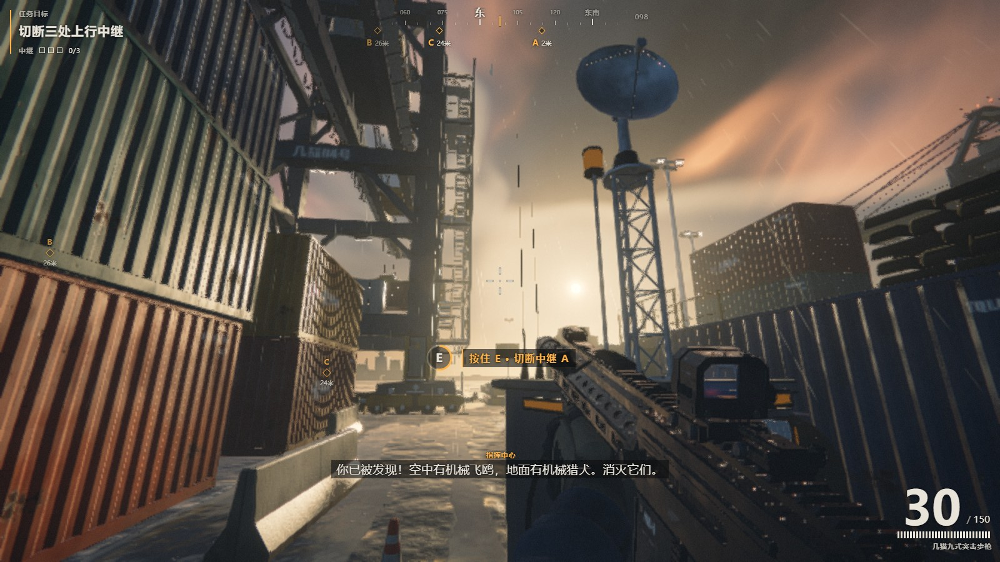 | 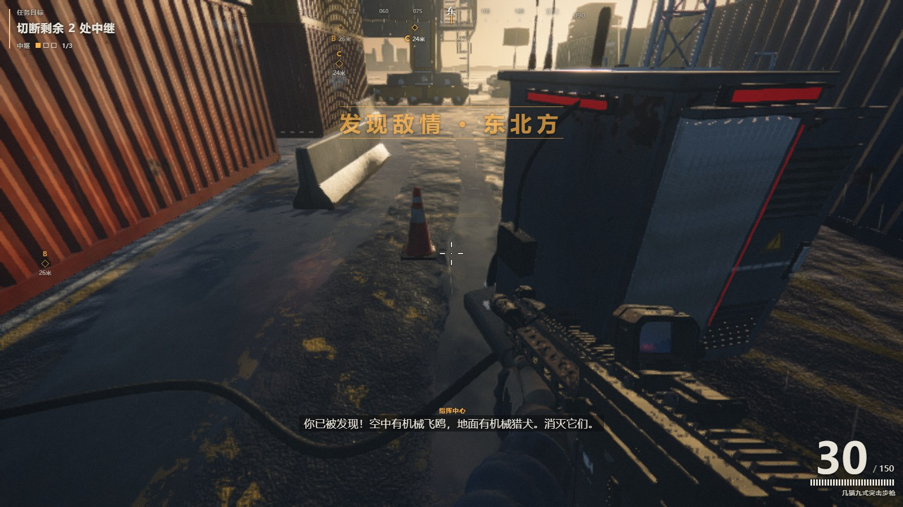 |
| **切断中继**：按住 E 交互环，中继塔与碟形天线 | **波次警告**：切断中继后敌情横幅与方位通报 |
| 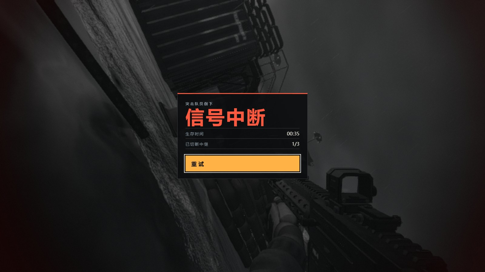 | 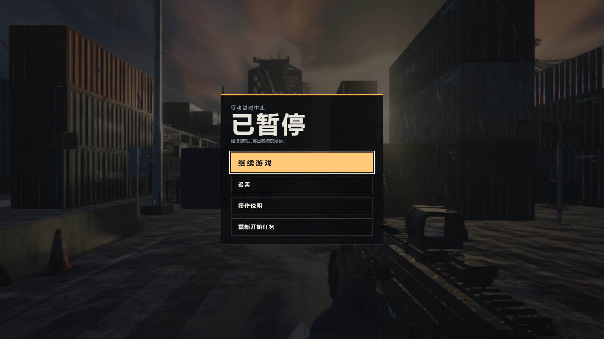 |
| **阵亡**：信号中断卡片，生存时间与中继进度 | **暂停**：行动暂时中止，继续/设置/重开 |
| 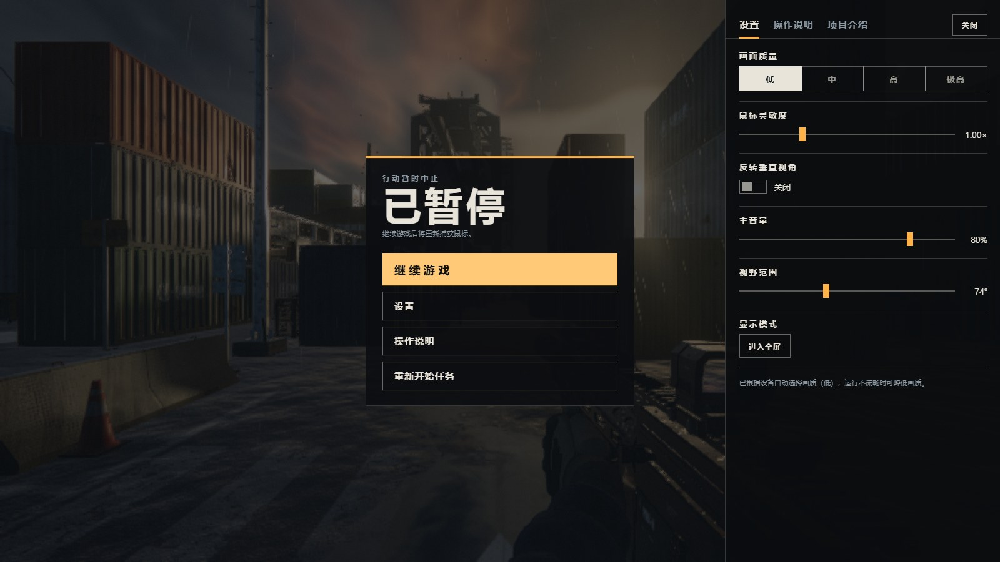 | 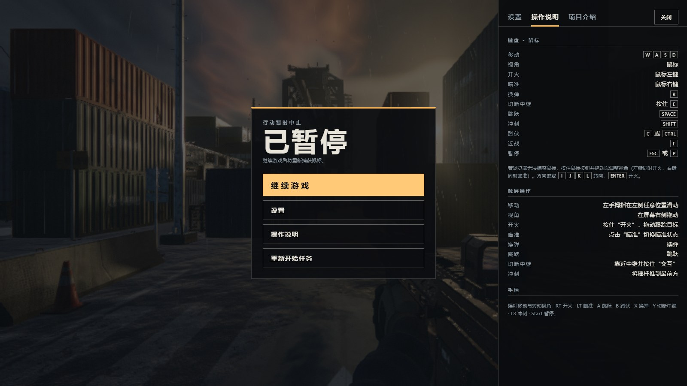 |
| **设置**：画质四档、灵敏度、反转、音量、FOV、全屏 | **操作说明**：键鼠 / 触屏 / 手柄三套方案 |
| 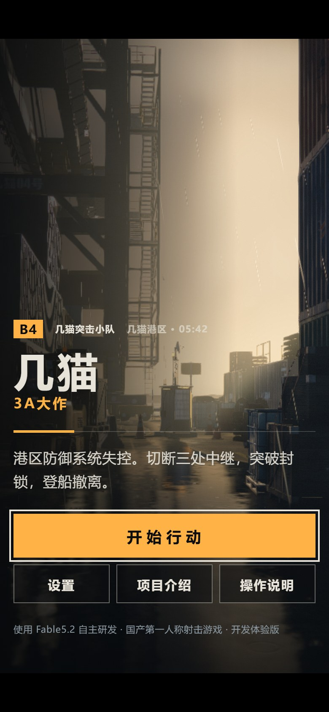 | 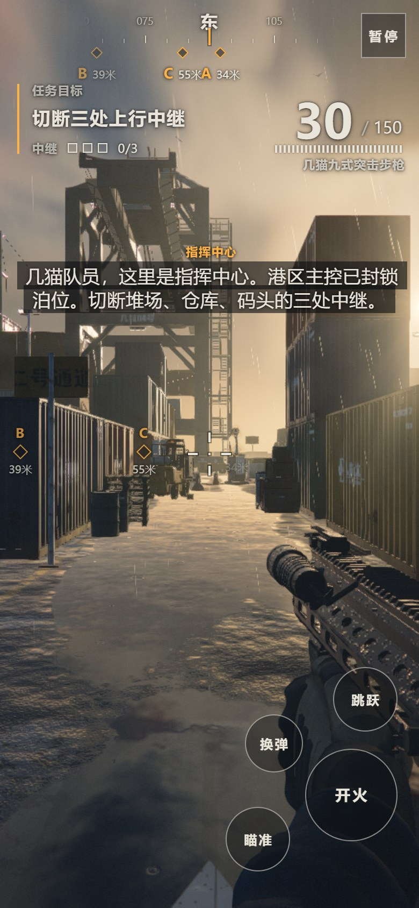 |
| **移动端标题**：竖屏排版与阅读 scrim | **移动端实战**：虚拟摇杆 + 开火/瞄准/换弹/跳跃 |

## 玩法循环

1. **潜入**：出生於四号泊位通道，罗盘与世界标记指引三处中继（堆场 A / 仓库 B / 码头 C）
2. **切断**：靠近中继按住 `E`，交互环读条完成即切断；每切断一处触发一波敌潮
3. **突围**：机械飞鸥（空中）与机械猎犬（地面）围攻；利用集装箱掩体、冲刺与蹲伏周旋
4. **撤离**：三处中继全部切断后封锁解除，前往撤离点登船
5. **简报**：按用时、命中率、摧毁数与重试次数给出行动评级

阵亡不惩罚进度以外的东西：重试从任务起点重新开始，中继计数归零。

## 操作

### 键盘 · 鼠标

| 动作 | 按键 | 动作 | 按键 |
|---|---|---|---|
| 移动 | `W` `A` `S` `D` | 跳跃 | `Space` |
| 视角 | 鼠标 | 冲刺 | `Shift` |
| 开火 | 鼠标左键 | 蹲伏 | `C` / `Ctrl` |
| 瞄准 | 鼠标右键 | 近战 | `F` |
| 换弹 | `R` | 暂停 | `Esc` / `P` |
| 切断中继 | 按住 `E` | 转向（无鼠标锁定时） | 方向键 / `I` `J` `K` `L` |

### 触屏

| 动作 | 操作 |
|---|---|
| 移动 | 左手拇指在左侧任意位置滑动（摇杆推满即冲刺） |
| 视角 | 屏幕右侧拖动 |
| 开火 / 瞄准 | 按住"开火"拖动跟踪 / 点击"瞄准"切换 |
| 换弹 / 跳跃 / 交互 | 屏幕按钮；靠近中继按住"交互" |

### 手柄

摇杆移动与转动视角 · `RT` 开火 · `LT` 瞄准 · `A` 跳跃 · `B` 蹲伏 · `X` 换弹 · `Y` 切断中继 · `L3` 冲刺 · `Start` 暂停

## 画面与设置

- **画质四档**（低 / 中 / 高 / 极高）：按设备自动选择，阴影与反射档位联动；切换后阴影和反射需要片刻重新生成
- **鼠标灵敏度** 0.2–3.0×、**反转垂直视角**、**主音量**、**视野范围**（默认 74°）、**全屏切换**
- 运行不流畅时降低画质即可；指针锁定不可用的环境（部分内嵌浏览器）自动降级为移动鼠标转向

## 技术架构

```
index.html (1.4MB, 单文件)
├─ CSS        深色 HUD / 菜单 / 触屏 / 动效偏好（prefers-reduced-motion）
├─ three.js   r180 内联压缩版（渲染器 / 场景 / 后处理链）
├─ GLSL       程序化天空 · AgX 调色 · PCSS 软阴影 · 湿地面/水洼/雨涟漪
│             锈迹掉漆损伤模型 · 集装箱标识磨损 · 闪烁灯光
├─ 游戏逻辑   任务状态机 · 波次调度 · 敌人 AI · 武器手感 · 命中判定
├─ WebAudio   全程序化音效合成（枪声/换弹/环境/音乐动机）
└─ DOM UI     罗盘带 · 目标标记 · 无线电字幕 · 四态菜单 · 设置面板
```

- **零外部请求**：无 CDN、无贴图、无音频文件；离线双击 `index.html` 同样可玩
- **后处理链**：场景 → 软阴影 → AgX（Filament/Blender 拟合）→ 显示线性调色 → 输出
- **地面材质**：双三次 B-spline 采样数据图，近距无像素边；湿度连续渐变驱动粗糙度与法线
- **性能**：帧 dt 钳制、画质分档、视锥剔除；软件渲染环境会自动降档

## 本地运行与部署

```bash
# 方式一：直接双击 index.html（file:// 协议即可运行）
# 方式二：本地静态服务
python -m http.server 8080
# 打开 http://localhost:8080
```

公网部署于 GitHub Pages（`main` 分支根目录）：推送后自动构建，约 1 分钟生效。
更新版本流程：将新版游戏覆盖为 `index.html` → 提交 → 推送。

## 路线图

- [ ] 更多武器与配件（霰弹 / 狙击、瞄具倍率）
- [ ] 敌人种类扩展与精英单位
- [ ] 关卡扩展：仓库 interior 与码头吊机顶层路线
- [ ] 设置与最佳成绩本地持久化
- [ ] 手柄震动与自适应扳机反馈

## 反馈与声明

欢迎通过 [Issues](https://github.com/odin1024/jimao/issues) 提交体验反馈、BUG 与建议。

> 本项目为使用 Fable5.2 自主研发的开发体验版，"国产 3A 大作"为宣传梗；距离国际顶尖 3A 水准还有一定差距，持续开发与优化中。期待与游戏开发、图形学及 AI 方向的朋友交流。

<div align="center">

**[▶ 再次出击](https://odin1024.github.io/jimao/)** · 几猫突击小队 · 四号泊位 · 05:42

</div>